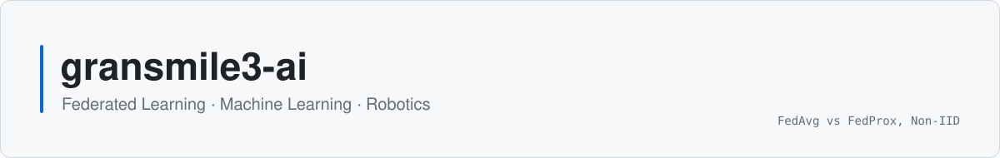
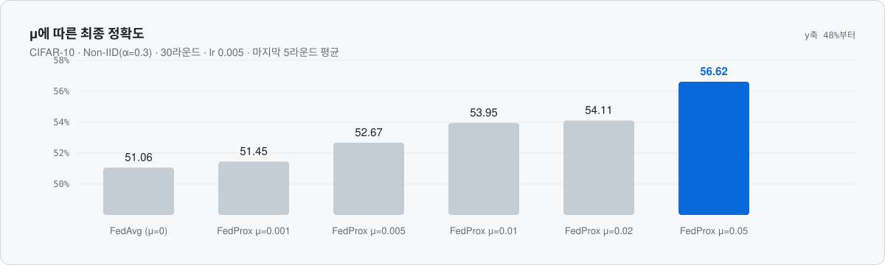

<picture>
  <source media="(prefers-color-scheme: dark)" srcset="https://raw.githubusercontent.com/gransmile3-ai/gransmile3-ai/main/assets/header-dark.svg">
  
</picture>

 

연합학습과 머신 언러닝을 공부하고 직접 돌려보는 학생입니다. 클라이언트마다 데이터 분포가 다른 Non-IID 상황에서 FedAvg와 FedProx가 어떻게 다른지, 학습한 데이터를 모델에서 지우는 방법(Gradient Ascent, FedEraser, SISA)이 얼마나 잘 지우는지를 실험으로 확인하고 있습니다. 로봇과 작곡 모델 프로젝트도 팀으로 함께 하고 있습니다.

|  연합학습 · 언러닝 | 로보틱스 | 음악 AI |
| --- | --- | --- |
| Flower, PyTorch FedAvg · FedProx 비교, 언러닝 방법 비교 | TurtleBot4, ROS 2 Jazzy, Nav2 도서관 서가 순회 자율주행 | MIDI 기반 작곡 모델 코드 진행을 조건으로 받는 생성 실험 |

### [federated-learning-unlearning-experiments](https://github.com/gransmile3-ai/federated-learning-unlearning-experiments)

Flower와 PyTorch로 만든 연합학습·언러닝 실험 모음입니다. 모든 실험은 CIFAR-10(일부 SVHN 등)을 쓰고, 조건마다 시드 1–3회 실행한 결과입니다.

**1. FedAvg vs FedProx (Non-IID, α=0.3)**

CIFAR-10을 두 클라이언트에 나눠 30라운드씩 비교했습니다. FedAvg는 8라운드쯤 정점을 찍고 내려갔고, μ를 키울수록 그 하락이 줄었습니다. 10라운드에서는 μ=0.01이 가장 좋았으니, 좋은 μ는 라운드 수에 따라 달라집니다.

<picture>
  <source media="(prefers-color-scheme: dark)" srcset="https://raw.githubusercontent.com/gransmile3-ai/gransmile3-ai/main/assets/chart-dark.svg">
  
</picture>

**2. 클라이언트 하나를 모델에서 지우기**

같은 설정에서 한 클라이언트의 데이터를 지우는 방법을 비교했습니다. 기준선은 나머지 클라이언트만으로 처음부터 다시 학습한 모델입니다.

| 방법 | 지운 클라이언트 데이터 정확도 | 재학습 비용 (local epoch) |
| --- | --- | --- |
| 원본 FedAvg | 0.593 | 120 |
| 재학습 (기준선) | 0.182 | 60 |
| Gradient ascent + 보정 1라운드 | 0.220 | 3.1 |
| FedEraser 변형 | 0.169 | 20 |
| SISA (샤드 = 클라이언트) | 0.153 | 0 |

Gradient ascent만 쓰면 모델이 무너지거나 거의 지우지 못했고, 원본 FedEraser는 라벨 편향이 심한 설정에서 발산해서, 이전·현재 방향을 섞는 변형을 썼습니다.

**3. 데이터셋 4개 × 모델 4개 언러닝 비교**

MNIST, SVHN, CIFAR-10, CIFAR-100과 CNN, MLP, ResNet-18, 작은 ViT 16개 조합에서 재학습, GA, GA+보정, SISA를 같은 레시피로 비교했습니다. SISA는 모든 조합에서 정확히 지우지만 비용이 재학습과 같았고, GA는 비용이 재학습의 1–4%인 대신 모델이 손상되거나 보정하면 지운 내용이 되살아났습니다.

한계도 적어두었습니다. 대부분 시드 1–3회이고 클라이언트도 2개뿐이라 작은 차이는 우연일 수 있습니다. 설정과 표 전체는 레포의 README와 `Unlearning/` 폴더에 있습니다.

### Tech

`Python` `PyTorch` `Flower` `ROS 2` `Linux` `Git`
